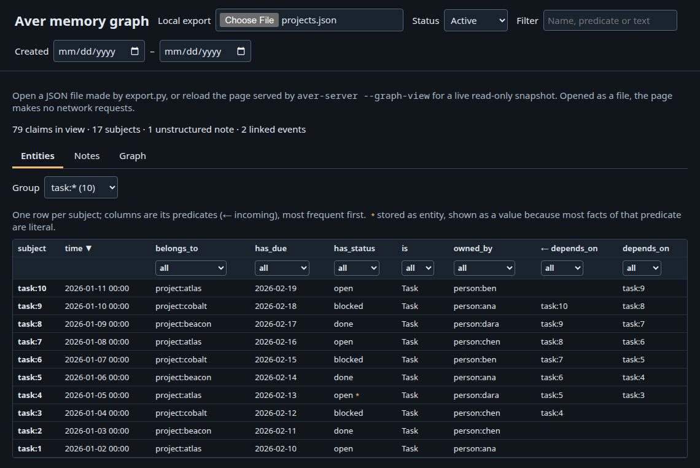

# aver

> *A memory for coding agents that writes every fact down twice: once in a plain log you can read, and once in a database it can always rebuild from that log.*

Every claim below links to the test that proves it ("proof"). CI runs those tests and the quickstart on every push and pull request, so this page can't quietly drift from the code.

---

## agents forget, or remember the wrong way

A coding agent starts every session with no memory of the last one. The usual fixes swing between two bad options. One is a pile of text chunks in a vector store, which is easy to write to and impossible to audit: nobody can say where a "memory" came from or whether it is still true. The other is a background process that rewrites the agent's notes on its own, which you have to trust blindly.

aver takes the boring route. A memory is a small structured fact, `PaymentGateway depends_on StripeSDK`, with a source, a confidence and the agent that wrote it. Every write is checked for secrets, appended to a log file first, and only then indexed. If the database is lost or suspect, aver rebuilds it from the log, and the result is identical. Nothing rewrites a memory behind your back: corrections, retirements and contradictions are new log entries, not edits.

It is written in Rust and runs locally (a command-line tool, `aver`, and a server, `aver-server`), local first: SQLite and a JSONL file in a directory you choose. Agents reach it over MCP, either through a small HTTP server with OAuth or as a child process on stdin/stdout.

## install it

You need a Rust toolchain (1.95 or newer). From a checkout of this repository:

<!-- quickstart -->
```bash
cargo install --locked --path crates/aver-cli
aver --memory-dir .aver status
aver --memory-dir .aver remember PaymentGateway depends_on StripeSDK --source session_47
aver --memory-dir .aver recall Stripe
```

Expected output:

```text
aver store: ok
claim_id=<number>
[global] PaymentGateway depends_on StripeSDK
```
<!-- /quickstart -->

`<number>` is the new claim's id, different on every run. The store is now two files: `.aver/log.jsonl`, the append-only log, and `.aver/db.sqlite`, the index rebuilt from it.

To give agents access, install the server too, `cargo install --locked --path crates/aver-server`, and see [connect an agent](#connect-an-agent). There are no prebuilt releases yet.

## what it does

- **Facts as triples, with provenance.** Each memory is subject, predicate, object, plus where it came from, a confidence, a status and the writing agent ([proof](crates/aver-core/tests/claims.rs "get_claim_returns_provenance_confidence_status_and_source_refs"), [proof](crates/aver-server/tests/oauth_scopes.rs "mcp_writes_stamp_agent_id_from_authenticated_client")).
- **The log is the source of truth.** Every write is appended to `log.jsonl` and mirrored into the database ([proof](crates/aver-core/tests/claims.rs "add_claim_appends_to_episodic_log_and_mirrors_to_sqlite")), and replaying the log rebuilds an identical database ([proof](crates/aver-core/tests/write_path.rs "replay_rebuild_is_identical")). `aver replay` does this on demand; it is strict by default and can quarantine bad lines instead ([proof](crates/aver-cli/tests/replay.rs "replay_strict_fails_and_lenient_quarantines")).
- **Secrets never get in.** API keys, tokens, private paths and high-entropy strings are rejected before anything is written, so they never reach the log ([proof](crates/aver-core/tests/privacy.rs "add_claim_rejects_secret_before_episodic_log_write"), [proof](crates/aver-core/tests/privacy.rs "privacy_filter_rejects_jwt"), [proof](crates/aver-core/tests/privacy.rs "privacy_filter_path_rejects_ssh_dir"), [proof](crates/aver-core/tests/privacy.rs "privacy_filter_rejects_high_entropy_token")).
- **A small, strict vocabulary.** Predicates come from an ontology with parents, aliases and cardinality. An unknown predicate is refused with suggestions to retry with ([proof](crates/aver-server/tests/tools.rs "remember_claim_unknown_predicate_typo_lists_vocabulary_and_suggestion")). A store can add its own predicates in an `ontology.json` next to it ([proof](crates/aver-core/tests/ontology_extension.rs "extension_adds_predicates_cardinality_aliases_and_types_on_open")).
- **Sentences stay sentences.** An object that is prose, a number or a quoted string is stored as a literal value, not turned into a graph node; short names stay entities ([proof](crates/aver-core/tests/structured_objects.rs "objects_keep_text_but_prose_and_numbers_are_not_entities")). A prose write gets a hint to split it into atomic facts, and `strict_atomic` refuses it instead ([proof](crates/aver-server/tests/structured_memory.rs "mcp_writes_expose_provenance_kind_event_and_atomicity_hint"), [proof](crates/aver-core/tests/structured_writes.rs "strict_prose_rejection_has_no_claim_log")).
- **The agent's own judgments are marked as such.** Writes through MCP default to `INFERRED` at confidence 0.45 ([proof](crates/aver-server/tests/structured_memory.rs "mcp_default_inference_and_explicit_provenance_reject_bad_inputs_before_append")), and an inferred claim is capped at 0.75 ([proof](crates/aver-server/tests/structured_memory.rs "mcp_writes_expose_provenance_kind_event_and_atomicity_hint")). `EXTRACTED` is meant for facts stated in a cited source; aver records the label but cannot check it.
- **Events, and claims that point at them.** An agent records what happened as an event, then cites the event's id on each claim it draws from it: two calls, and every claim points at its source ([proof](crates/aver-server/tests/structured_memory.rs "event_then_claim_is_a_cheap_scope_correct_public_workflow")). Claims can also be staged as candidates and promoted or rejected after review ([proof](crates/aver-cli/tests/episode_flow.rs "record_event_propose_promote_recall_integration")).
- **Recall by keyword, or hybrid with embeddings.** Without an embedding provider, recall is keyword search over active claims ([proof](crates/aver-cli/tests/recall.rs "recall_prints_claim_matching_keyword")). With one, recall blends vector similarity and graph structure ([proof](crates/aver-server/tests/embed_on_write.rs "opted_in_writes_get_a_vector_chunk_and_hybrid_recall")), and falls back to keywords if the provider fails ([proof](crates/aver-server/tests/hybrid_recall.rs "recall_falls_back_to_keyword_when_query_embedding_fails")).
- **Scopes keep projects apart.** Every memory has a scope such as `proj/aver`. Recall can read a scope and its parents, only that scope, its children, or everything ([proof](crates/aver-cli/tests/scope_cli.rs "recall_with_scope_walk_filters_results")).
- **Corrections leave a trail.** Retiring a claim ([proof](crates/aver-server/tests/shared_store.rs "retire_claim_over_mcp_invalidates_the_stored_claim")), recording a contradiction, or consolidating duplicates are new log entries; the old claim stays readable in history ([proof](crates/aver-core/tests/claims.rs "contradict_records_auditable_contradiction_without_deleting_claim"), [proof](crates/aver-core/tests/claims.rs "consolidate_supersedes_older_conflicting_claim")). A single-valued fact that changes supersedes the old one; a multi-valued one keeps every value ([proof](crates/aver-core/tests/predicate_cardinality.rs "multi_valued_predicates_keep_every_object_through_consolidation")).
- **Knowing when a fact was last checked.** A claim can say under which context it holds and for how long. A reviewer confirms it with cited evidence, and recall reports how much new matching evidence has arrived since that confirmation ([proof](crates/aver-core/tests/claim_validity.rs "reverify_records_its_writer_and_evidence_and_only_extends_the_window"), [proof](crates/aver-server/tests/claim_validity.rs "recall_shows_validity_only_for_contextual_or_confirmed_claims")).
- **Code facts without a model.** `aver extract <path>` reads source code with Tree-sitter in 13 languages (C, C++, C#, Go, Java, JavaScript, Kotlin, PHP, Python, Ruby, Rust, Swift, TypeScript; [proof](crates/aver-extractor/tests/multilang.rs "extract_common_language_basic_symbols_emit_definition_facts"), [proof](crates/aver-extractor/tests/multilang.rs "extract_python_classes_and_go_type_symbols_emit_definition_facts"), [proof](crates/aver-extractor/tests/multilang.rs "extract_python_facts_emits_file_defines_function_triple"), [proof](crates/aver-extractor/tests/multilang.rs "extract_typescript_facts_emit_interface_extends_triple"), [proof](crates/aver-extractor/tests/rust.rs "extract_rust_facts_emits_file_defines_function_triple")) and stores definitions, calls, imports and tests as claims in the project's scope ([proof](crates/aver-cli/tests/extract.rs "extract_then_recall_returns_project_scoped_code_claims")).

## connect an agent

**Over HTTP**, for agents that connect to a server (Claude Code, VS Code and other MCP clients with OAuth). Start `aver-server`; it listens on `127.0.0.1:3317`. The client registers itself ([proof](crates/aver-server/tests/http_routes.rs "oauth_register_route_creates_public_client")), your browser shows a consent screen listing what it may do, and after you approve ([proof](crates/aver-server/tests/oauth_consent_flow.rs "approve_decision_records_consent_redirects_with_code_and_skips_screen")), the client gets a token limited to the scopes you ticked ([proof](crates/aver-server/tests/oauth_scopes.rs "approve_records_granted_scopes_on_consent_row_and_token"), [proof](crates/aver-server/tests/oauth_scopes.rs "read_only_scope_allows_recall_but_rejects_writes")). Tokens refresh, and a reused refresh token revokes the whole token family ([proof](crates/aver-server/tests/refresh_and_cors.rs "refresh_token_reuse_revokes_token_family")). Callers from other machines are refused unless a trusted reverse proxy vouches for them ([proof](crates/aver-server/tests/http_routes.rs "oauth_authorize_route_rejects_non_loopback_with_html_403")). A VS Code workspace entry:

```json
{ "servers": { "aver": { "type": "http", "url": "http://127.0.0.1:3317/mcp" } } }
```

Each write is attributed to the client that made it ([proof](crates/aver-server/tests/oauth_scopes.rs "mcp_writes_stamp_agent_id_from_authenticated_client")). `contrib/systemd/aver-mcp.service` runs the server as a user service.

**Over stdio**, for agent hosts that start MCP servers as child processes. No port, no OAuth: the parent process is the only client, and the store directory's file permissions are the access control ([proof](crates/aver-server/tests/stdio.rs "stdio_session_grants_every_scope_and_keeps_stdout_for_the_protocol")). Several children can share one store ([proof](crates/aver-server/tests/stdio.rs "two_stdio_children_share_one_store_and_the_log_replays_to_the_same_state")).

```yaml
mcp_servers:
  aver:
    command: /path/to/aver-server
    args: ["--stdio"]
    env:
      AVER_MEMORY_DIR: /path/to/store
```

The server offers 16 tools and tells agents to start with five: `recall`, `remember_claim`, `record_event`, `add_triple` and `retire_claim` ([proof](crates/aver-server/tests/mcp_instructions.rs "mcp_instructions_are_a_progressive_discovery_card")). The rest (graph expansion, event lookup, candidate review, contradiction, reverification, consolidation, vector chunks) is described in the server's own instructions for when an agent needs it.

## embeddings, optional

Embeddings are off until you configure a provider, and one provider serves a store.

- **Ollama:** set `AVER_EMBEDDING_URL` to its address. Text stays on machines you run ([proof](crates/aver-server/tests/embedding_provider.rs "unset_configuration_is_unchanged")).
- **OpenAI-compatible:** set `AVER_EMBEDDING_PROVIDER=openai` and the key in `OPENAI_API_KEY`. **The text of every embedded claim and every recall query is then sent to that endpoint.** The privacy check still runs first, so rejected text is never sent ([proof](crates/aver-server/tests/embed_on_write.rs "rejected_writes_send_nothing_to_the_provider")), and the key is never logged or stored ([proof](crates/aver-core/tests/openai_embedding.rs "provider_errors_never_carry_the_response_body_or_the_key")).
- **Embed on write:** with `AVER_EMBED_ON_WRITE=1`, every claim written through the server also gets a vector, so ordinary memories take part in hybrid recall ([proof](crates/aver-server/tests/embed_on_write.rs "opted_in_writes_get_a_vector_chunk_and_hybrid_recall")). The claim is saved first; if the provider fails, the claim stays keyword-only ([proof](crates/aver-server/tests/embed_on_write.rs "provider_failure_keeps_the_claim_and_reports_keyword_only")) until `aver backfill` embeds what is missing ([proof](crates/aver-cli/src/main.rs "backfill_command_fills_missing_vectors_and_is_idempotent")).
- **Recency, opt-in:** `AVER_RECALL_RECENCY_WEIGHT` makes recently confirmed claims rank higher ([proof](crates/aver-eval/tests/recency.rs "documented_recency_weight_ranks_fresh_claims_first_and_keeps_the_control")); at 0 the ranking is unchanged ([proof](crates/aver-core/tests/recency.rs "zero_weight_is_bit_identical_to_relevance_only_for_every_age")).

Don't switch provider or model on a store that already holds vectors: vectors from different models can't be compared. Start a new store instead.

## look at what it remembers

[contrib/graph/graph.html](contrib/graph/graph.html) is a single offline page that shows a store as tables of entities, free-text notes, and a graph around whatever you select, with each claim's provenance and history ([proof](contrib/graph/test_graph.js "graph_tabs_date_range_and_all_history_use_synthetic_fixture")). Open it on an export made by `python3 contrib/graph/export.py <db.sqlite> <out.json>`, which reads the store read-only ([proof](contrib/graph/test_export.py "test_empty_store_and_readonly_input")). Or start `aver-server --graph-view` to serve the same page at `/graph`; it needs a read token ([proof](crates/aver-server/tests/graph_view.rs "snapshot_requires_a_bearer_token_with_claims_read")) and never writes ([proof](crates/aver-server/tests/graph_view.rs "reads_committed_state_without_changing_the_store_under_a_live_writer")). Details: [contrib/graph/README.md](contrib/graph/README.md).



## what runs where, and what it does not do

- **On your machine:** everything. The store is a SQLite file and a JSONL log in one directory. The only network traffic is to the embedding provider you configure, if any.
- **Not a hosted service.** It is built for one person's agents on one machine or one trusted network. Put it behind HTTPS and a trusted proxy before exposing it anywhere else.
- **No language model inside.** The CLI and the server never ask a model to decide anything; the only model they call is the embedding provider you configure. (The benchmark harness in `crates/aver-eval` does call models, to answer and judge benchmark questions.) It stores what agents tell it, checks it, and finds it again. Deciding what is worth remembering is the agent's job.
- **No background rewriting.** Nothing merges, decays or deletes memories on its own. Consolidation runs only when asked, and it only adds log entries. Recall never writes anything ([proof](crates/aver-server/tests/recall_read_only.rs "recall_leaves_log_and_database_bytes_unchanged")).
- **No graph database.** Graph questions (neighbourhoods, related facts) are answered from SQLite.

## settings

The server reads its settings from the environment. The defaults suit a local install.

| Variable | Default | What it does |
|---|---|---|
| `AVER_MEMORY_DIR` | `.aver` | Store directory ([proof](crates/aver-server/tests/config.rs "auth_db_path_defaults_under_default_memory_dir")) |
| `AVER_HOST` / `AVER_PORT` / `AVER_BASE_URL` | `127.0.0.1` / `3317` / `http://127.0.0.1:3317` | Where the HTTP server listens and how it names itself in OAuth metadata ([proof](crates/aver-server/tests/config.rs "server_config_defaults_to_loopback_port_and_derived_base_url")) |
| `AVER_DEFAULT_SCOPE` | `global` | Scope for writes that name none ([proof](crates/aver-server/tests/scope_resolution.rs "falls_back_to_global_when_nothing_set"), [proof](crates/aver-server/tests/scope_resolution.rs "env_used_when_no_param_or_headers")) |
| `AVER_TRUSTED_AUTH_HEADER` | unset | Header from a trusted proxy that lets non-local callers sign in ([proof](crates/aver-server/tests/oauth_consent_flow.rs "non_loopback_get_authorize_with_trusted_header_is_allowed")) |
| `AVER_CORS_ORIGINS` | any origin on a loopback host, else only the base URL | Allowed browser origins ([proof](crates/aver-server/tests/refresh_and_cors.rs "unset_cors_origins_allow_any_on_loopback_and_only_base_url_elsewhere")) |
| `AVER_EMBEDDING_PROVIDER` | `ollama` | `ollama` or `openai` ([proof](crates/aver-server/tests/embedding_provider.rs "openai_provider_needs_its_key_and_labels_chunks_with_its_model")) |
| `AVER_EMBEDDING_URL` | unset (`https://api.openai.com/v1` for openai) | Provider address; for Ollama, setting it turns embeddings on ([proof](crates/aver-server/tests/embedding_provider.rs "unset_configuration_is_unchanged")) |
| `AVER_EMBEDDING_MODEL` | `nomic-embed-text` / `text-embedding-3-small` | Embedding model, recorded on each vector ([proof](crates/aver-server/tests/embedding_provider.rs "openai_provider_needs_its_key_and_labels_chunks_with_its_model")) |
| `AVER_EMBEDDING_API_KEY_ENV` | `OPENAI_API_KEY` | Which variable holds the key; without a key, recall stays keyword-only ([proof](crates/aver-server/tests/embedding_provider.rs "openai_provider_needs_its_key_and_labels_chunks_with_its_model")) |
| `AVER_EMBEDDING_TIMEOUT_SECS` | `10` | Per-request timeout; on timeout recall uses keywords ([proof](crates/aver-server/tests/stdio.rs "stdio_embedding_call_is_bounded_by_the_configured_timeout")) |
| `AVER_EMBED_ON_WRITE` | unset | `1` embeds every claim written through the server ([proof](crates/aver-server/tests/embed_on_write.rs "opted_in_writes_get_a_vector_chunk_and_hybrid_recall"), [proof](crates/aver-server/tests/embed_on_write.rs "unset_omits_embedding_field_makes_no_request_or_chunk")) |
| `AVER_RECALL_RECENCY_WEIGHT` / `_TAU_DAYS` | `0` / `90` | Opt-in recency ranking ([proof](crates/aver-server/tests/config.rs "recall_ranking_reads_recency_tau_and_evidence_half_life_from_env")) |
| `AVER_RECALL_EVIDENCE_HALF_LIFE` | unset | Opt-in ranking by unreviewed new evidence; stored confidence never changes ([proof](crates/aver-core/tests/claim_validity.rs "evidence_ranking_is_opt_in_and_leaves_confidence_alone")) |

## the command line

`aver --help` lists every command. The ones you will reach for:

- `remember`, `recall`: write and find a fact (see the quickstart).
- `record-event`, `propose`, `promote`, `reject`, `list-candidates`: record what happened and review the claims drawn from it ([proof](crates/aver-cli/tests/episode_flow.rs "record_event_propose_promote_recall_integration"), [proof](crates/aver-cli/tests/episode_flow.rs "reject_candidate_sets_status")).
- `expand`: show the facts around an entity ([proof](crates/aver-cli/tests/maintenance.rs "expand_command_prints_local_graph")).
- `reverify`, `confirmations`: confirm a claim with evidence, and list its confirmations ([proof](crates/aver-cli/tests/maintenance.rs "reverify_command_records_claim_confirmation"), [proof](crates/aver-cli/tests/maintenance.rs "confirmations_command_lists_claim_evidence")).
- `contradict`, `consolidate`: record a conflict; fold duplicates and supersede outdated single-valued facts ([proof](crates/aver-cli/tests/maintenance.rs "contradict_command_records_contradiction"), [proof](crates/aver-cli/tests/maintenance.rs "consolidate_command_supersedes_duplicate_claims")).
- `backfill`: embed stored text that has no vector yet ([proof](crates/aver-cli/src/main.rs "backfill_command_fills_missing_vectors_and_is_idempotent")).
- `extract`: store code facts from a source tree (see above).
- `replay`, `vacuum`, `migrate-literals`: rebuild the database from the log, compact it, and convert sentence objects in an older store to literals ([proof](crates/aver-cli/tests/replay.rs "replay_strict_fails_and_lenient_quarantines"), [proof](crates/aver-cli/tests/maintenance.rs "vacuum_command_writes_analyzed_copy"), [proof](crates/aver-cli/tests/maintenance.rs "migrate_literals_command_reclassifies_legacy_objects_idempotently")).

## develop

```bash
just check      # fmt, clippy, all tests, and the project's policy checks
just test       # tests only
```

Without `just`, the [`justfile`](justfile) shows the plain cargo commands. The benchmark harness in `crates/aver-eval` runs fixture evaluations and the BEAM100K benchmark against an in-process store or a running server.

## FAQ

**Does it need a GPU or a model?** No. Embeddings are optional, and the model that makes them runs wherever you point it.

**What happens if the database gets corrupted?** Delete it and run `aver replay`. The log is the source of truth, and the rebuilt database is identical ([proof](crates/aver-core/tests/write_path.rs "replay_rebuild_is_identical")).

**Can an agent delete memories?** No. It can retire a claim or record a contradiction, and both are new log entries, so the history stays ([proof](crates/aver-core/tests/claims.rs "contradict_records_auditable_contradiction_without_deleting_claim")).

**Can I run several agents on one store?** Yes. Writes from several processes are serialised by a lock and a SQLite transaction ([proof](crates/aver-server/tests/stdio.rs "two_stdio_children_share_one_store_and_the_log_replays_to_the_same_state")).

### Documents

- **[doc/how-it-works.md](doc/how-it-works.md)**: how a write and a recall flow through the code.
- **[doc/structured-memory.md](doc/structured-memory.md)**: literals vs entities, the decision vocabulary, claim validity, and migrating an old store.
- **[doc/adr/](doc/adr/)**: every design decision and why it was made.
- **[LICENSE](LICENSE)**: MIT.
